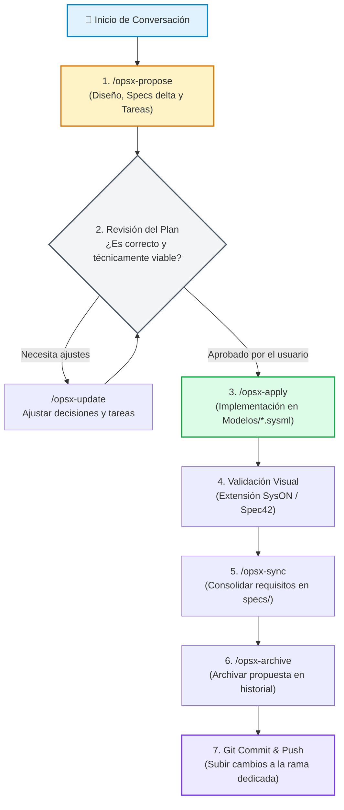

# Guía de Trabajo: OpenSpec en SysML v2 y Entornos con Agentes de IA

Bienvenido a la metodología oficial de trabajo del proyecto. Este documento explica cómo colaborar de forma rigurosa y ordenada utilizando **OpenSpec**, **Git** y **SysML v2** asistidos por agentes inteligentes (Antigravity / VS Code).

---

> [!IMPORTANT]
> ### 🛑 Requisito Obligatorio al Iniciar Cada Conversación
> **Todo cambio o petición sobre los modelos debe comenzar utilizando la herramienta OpenSpec.**
>
> Cada vez que abras una conversación con el agente de IA para añadir, modificar o refactorizar cualquier elemento del coche, **DEBES iniciar tu petición invocando OpenSpec** (mediante el comando `/opsx-propose`, `/openspec-propose` o solicitando explícitamente una propuesta OpenSpec).
>
> ❌ **Prohibido:** *"Añade un motor de 50kW al coche"* (provoca cambios sin planificar que rompen la sincronización).  
> ✔️ **Correcto:** *"`/opsx-propose Diseñar el subsistema Powertrain con motor eléctrico de 50 kW, masa estimada de 35 kg y puertos de par`"*.

---

## 1. ¿Por qué usamos OpenSpec en Ingeniería de Sistemas?

En el desarrollo de sistemas con SysML v2 asistido por IA, OpenSpec introduce el enfoque **Desarrollo Guiado por Especificaciones (*Spec-Driven Development*)**:

| Desafío sin OpenSpec | Solución con OpenSpec |
| :--- | :--- |
| **Alucinaciones y saltos al código:** La IA escribe bloques `.sysml` sin verificar compatibilidad ni balance de masas. | **Fase de diseño previa obligatoria:** El agente debe acordar diseño, especificaciones verificables y tareas antes de tocar un solo archivo. |
| **Pérdida de contexto en el chat:** Los acuerdos de diseño se pierden al cerrar la ventana de conversación. | **Registro en el repositorio:** Cada requisito y decisión queda registrado en `openspec/` y versionado en Git para todo el equipo. |
| **Rotura de requisitos existentes:** Cambios rápidos que contradicen condiciones de seguridad o masa máxima. | **Blindaje de requisitos:** Bloqueo de seguridad automático si una propuesta colisiona con un requisito vigente. |
| **Código desordenado:** Diferentes criterios entre los integrantes del grupo. | **Sincronización de arquitectura:** Vocabulario común y ciclo unificado de trabajo colaborativo. |

---

## 2. Ciclo de Vida de un Cambio

El siguiente flujo resume las fases secuenciales de cualquier iteración sobre el coche:



---

## 3. Guía Paso a Paso con Ejemplos de SysML v2

### Paso 0: Asegurar tu Rama de Trabajo
Nunca trabajes sobre la rama `main`. Crea siempre una rama temática:
```bash
git checkout -b feature/subsistema-frenos
```

### Paso 1: Lanzar la Propuesta al Iniciar la Conversación
Inicia el diálogo con la IA indicando el comando de propuesta y el alcance concreto:
```text
/opsx-propose Modelar el subsistema de Frenos con pinzas hidráulicas, masa de 12 kg y requisito de desaceleración mínima de 6 m/s²
```
El agente creará en `openspec/changes/<nombre-cambio>/` cuatro artefactos clave:
* 📄 **`proposal.md`**: Justificación del cambio y subsistemas involucrados.
* 📋 **`specs/`**: Requisitos verificables del subsistema en formato delta.
* 📐 **`design.md`**: Decisiones de modelado SysML v2, puertos y balance de masas.
* ✅ **`tasks.md`**: Lista ordenada de tareas atómicas para implementar.

### Paso 2: Revisar y Ajustar la Planificación
Revisa los archivos generados en `openspec/changes/`. Si quieres cambiar una masa o añadir un puerto:
> *"Ajusta la masa a 14 kg y añade un puerto para sensor de desgaste."*  
*(O utiliza `/opsx-update` para rearmar el plan).*

### Paso 3: Aplicar el Cambio en los Modelos
Una vez conforme con la planificación, da la orden de implementar:
```text
/opsx-apply
```
El agente editará o creará los archivos `.sysml` en `Modelos/` cumpliendo estrictamente con la sintaxis OMG SysML v2.

### Paso 4: Validar Visualmente en VS Code
Abre el diagrama con la **extensión SysON** en VS Code para verificar que:
1. Las cajas y puertos mecánicos/eléctricos están bien definidos.
2. Las líneas `connect` enlazan los puertos correctos.
3. No hay errores de tipo ni de importación de paquetes.

### Paso 5: Sincronizar y Archivar
Consolida los nuevos requisitos en la base central y archiva la propuesta:
```text
/opsx-sync
/opsx-archive
```

### Paso 6: Confirmar en Git
Sube el código y el estado limpio de las especificaciones:
```bash
git add .
git commit -m "feat(frenos): modelado subsistema frenos y requisitos de frenado"
git push origin feature/subsistema-frenos
```

---

## 4. Catálogo Rápido de Comandos Slash

| Comando | Acción Principal | ¿Cuándo ejecutarlo? |
| :--- | :--- | :--- |
| **`/opsx-propose`** | Crea la propuesta técnica, diseño, requisitos y tareas. | **Al inicio de la conversación** para plantear cualquier cambio. |
| **`/opsx-explore`** | Sesión de diálogo para explorar alternativas o aclarar dudas técnicas. | Cuando no tienes claro el diseño antes de proponerlo. |
| **`/opsx-apply`** | Ejecuta las tareas en los archivos `Modelos/*.sysml`. | Tras validar y aprobar la propuesta. |
| **`/opsx-update`** | Actualiza y reconcilia los 4 artefactos de la propuesta activa. | Si necesitas cambiar requisitos o alcance en mitad del cambio. |
| **`/opsx-sync`** | Copia las especificaciones delta a `openspec/specs/`. | Al terminar la implementación del código. |
| **`/opsx-archive`** | Mueve el cambio completado a `openspec/changes/archive/`. | Como cierre para dejar limpio el entorno de trabajo. |

---

## 5. Preguntas Frecuentes y Buenas Prácticas

> [!TIP]
> **¿Qué pasa si olvido especificar la masa de un componente?**  
> La IA tiene la obligación (por reglas de `AGENTS.md`) de recordártelo y sugerir un peso físicamente verosímil tipado con `TiposBase::Mass` en kilogramos.

> [!WARNING]
> **¿Puedo pedirle al agente que edite `Modelos/` directamente sin OpenSpec?**  
> **No.** El agente tiene orden estricta de rechazar o redirigir cualquier edición directa de modelos hacia una propuesta de OpenSpec. Esto previene desincronizaciones entre el equipo y roturas silenciosas de modelos.

> [!NOTE]
> **¿Es necesario ejecutar `openspec init` cada vez?**  
> **No.** El repositorio ya está inicializado. Solo necesitas abrir la carpeta en VS Code y lanzar `/opsx-propose`.