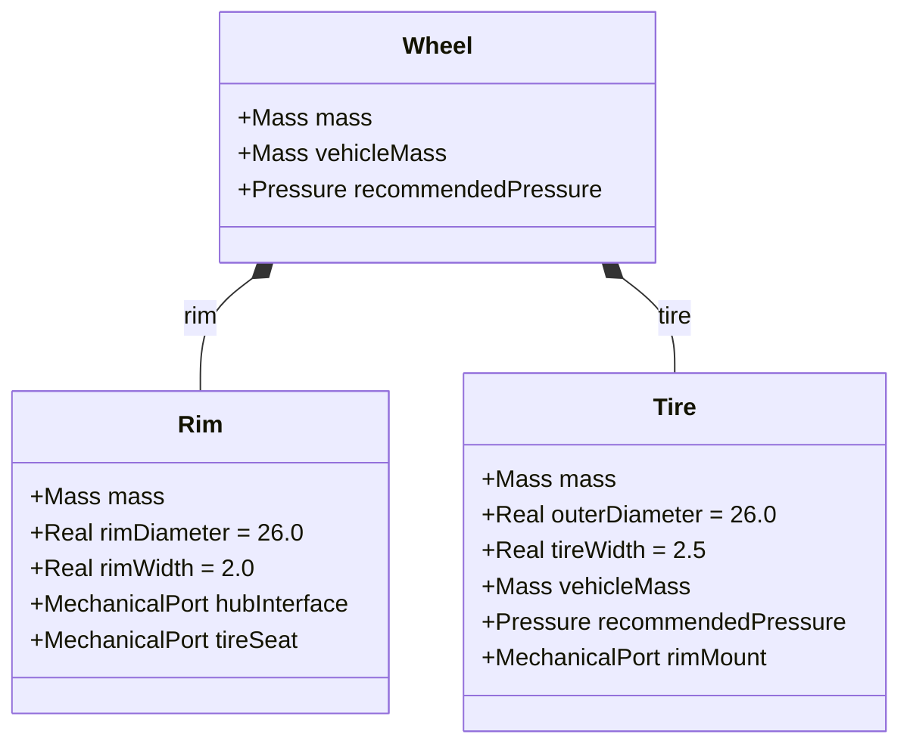
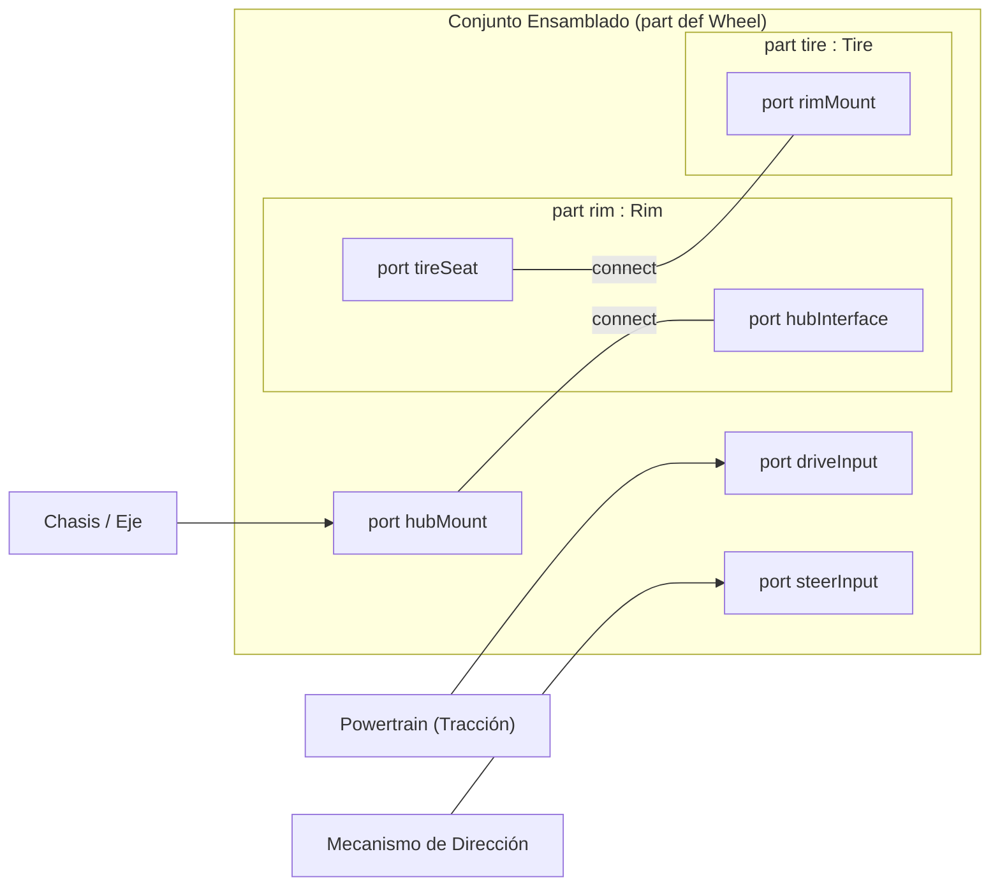

# Guía Pedagógica: Funcionamiento y Modelado de la Rueda en SysML v2

Este documento describe con fines formativos la arquitectura, sintaxis y funcionamiento del archivo [`Modelos/05_rueda.sysml`](file:///C:/Users/joseev/OneDrive%20-%20Universidad%20de%20Oviedo/Universidad/Cuarto/Primer%20Cuatri/Robotica%20industrial/Coche-sysml-/Modelos/05_rueda.sysml), correspondiente al subsistema de rueda del triciclo eléctrico ligero.

---

## 1. Visión General del Paquete (`SubsistemaRueda`)

El subsistema se encapsula dentro de un paquete SysML v2:

```sysml
package SubsistemaRueda {
    doc /* Definicion del conjunto de rueda descompuesto en llanta y neumatico */
    private import ScalarValues::*;
    private import TiposBase::*;
    ...
}
```

### Conceptos Clave:
- **`package`**: Espacio de nombres que agrupa de forma modular todos los elementos relacionados con la rueda, evitando colisiones con otros subsistemas (chasis, powertrain, dirección).
- **`doc /* ... */`**: Documentación formal integrada en el propio modelo de SysML v2.
- **`private import`**: Importa definiciones requeridas únicamente para el ámbito interno de este paquete:
  - `ScalarValues::*`: Proporciona tipos primitivos estándar como `Real`.
  - `TiposBase::*`: Proporciona tipos de datos del proyecto definidos en [`00_tipos_base.sysml`](file:///C:/Users/joseev/OneDrive%20-%20Universidad%20de%20Oviedo/Universidad/Cuarto/Primer%20Cuatri/Robotica%20industrial/Coche-sysml-/Modelos/00_tipos_base.sysml) (como la magnitud física `Mass`, el tipo `Pressure` y la interfaz `MechanicalPort`).
- **Motivación física**: En ingeniería automotriz, una rueda no es un bloque homogéneo; está formada por un elemento rígido estructural que soporta el anclaje y el par (la llanta) y un elemento deformable que asegura la adherencia y amortiguación mediante aire a presión (el neumático). Modelarlos por separado permite asignarles propiedades mecánicas, restricciones de masa y fórmulas de inflado independientes.

---

## 2. Tabla de Magnitudes Físicas, Atributos y Unidades

Para evitar ambigüedades en el dimensionamiento, las propiedades físicas del modelo siguen la siguiente tabla de magnitudes:

| Elemento | Atributo | Tipo de Dato SysML v2 | Unidad de Ingeniería | Significado Físico |
| :--- | :--- | :--- | :--- | :--- |
| `Rim` | `mass` | `Mass` | Kilogramos ($\text{kg}$) | Masa estructural de la llanta |
| `Rim` | `rimDiameter` | `Real` | Pulgadas ($\text{in} \approx 25.4\text{ mm}$) | Diámetro nominal de la llanta ($26"$) |
| `Rim` | `rimWidth` | `Real` | Pulgadas ($\text{in}$) | Ancho de garganta de la llanta ($2.0"$) |
| `Tire` | `mass` | `Mass` | Kilogramos ($\text{kg}$) | Masa de la cubierta y cámara |
| `Tire` | `outerDiameter`| `Real` | Pulgadas ($\text{in}$) | Diámetro exterior total de rodadura |
| `Tire` | `tireWidth` | `Real` | Pulgadas ($\text{in}$) | Balón / ancho del neumático ($2.5"$) |
| `Tire` | `vehicleMass` | `Mass` | Kilogramos ($\text{kg}$) | Carga vertical del vehículo asignada a la rueda |
| `Tire` / `Wheel` | `recommendedPressure` | `Pressure` | Bares ($\text{bar}$) | Presión manométrica de inflado recomendada |
| `Wheel` | `mass` | `Mass` | Kilogramos ($\text{kg}$) | Masa total del conjunto ensamblado |

---

## 3. Descomposición Estructural (Diagrama BDD)

En SysML v2, la estructura física se modela distinguiendo entre **definiciones de parte** (`part def`) y **usos de parte** (`part`).

### 3.1 Definiciones de Parte

1. **`part def Rim` (Llanta)**:
   - Representa la estructura metálica que se ancla al buje del vehículo y sobre la que asienta la cubierta.
   - **Atributos**: `mass : Mass`, `rimDiameter : Real = 26.0`, `rimWidth : Real = 2.0`.
   - **Puertos**:
     - `hubInterface : MechanicalPort`: Puerto para atornillar/acoplar al buje del eje.
     - `tireSeat : MechanicalPort`: Asiento perimetral donde sella el talón del neumático.

2. **`part def Tire` (Neumático)**:
   - Representa la cubierta elástica que contiene la cámara de aire y hace contacto con el suelo.
   - **Atributos**: `mass : Mass`, `outerDiameter : Real = 26.0`, `tireWidth : Real = 2.5`, `vehicleMass : Mass`, `recommendedPressure : Pressure`.
   - **Puertos**:
     - `rimMount : MechanicalPort`: Labio de montaje que asienta sobre la llanta.

3. **`part def Wheel` (Conjunto Rueda Ensamblado)**:
   - Agrupa la llanta y el neumático mediante composición (`part rim : Rim;` y `part tire : Tire;`).
   - Expone atributos globales del conjunto (`mass`, `vehicleMass`, `recommendedPressure : Pressure`).

### 3.2 Diagrama Conceptual BDD (Jerarquía de Partes)



---

## 4. Modelado Paramétrico y Restricciones (`assert constraint`)

SysML v2 permite definir restricciones matemáticas mediante `assert constraint`. Estas ecuaciones no son meras asignaciones, sino relaciones invariantes que el solver o validador del modelo debe garantizar.

### 4.1 Presión recomendada del neumático (`calculateTirePressure`)

```sysml
assert constraint calculateTirePressure {
    recommendedPressure == 1.8 + (vehicleMass * 0.012)
}
```
- **Significado físico**: La presión recomendada parte de una presión base de $1.8\text{ bar}$ (vehículo en vacío) y se incrementa linealmente en función de la masa soportada ($0.012\text{ bar/kg}$).

#### Ejemplo numérico paso a paso:
Si el triciclo tiene una masa total de $75\text{ kg}$ distribuida entre sus 3 ruedas y consideramos que una rueda delantera soporta una carga $m = 25\text{ kg}$:
$$\text{recommendedPressure} = 1.8 + (25 \times 0.012) = 1.8 + 0.30 = 2.10\text{ bar}$$
Este valor resultante es de tipo `Pressure` y satisface holgadamente el margen seguro operativo ($1.8\text{ bar} \le 2.10\text{ bar} \le 3.5\text{ bar}$).

### 4.2 Balance de masa del conjunto (`wheelMassBalance`)

```sysml
assert constraint wheelMassBalance {
    mass == rim.mass + tire.mass
}
```
- **Significado físico**: Garantiza la conservación de la masa total; la masa de la rueda ensamblada es exactamente la suma de su llanta y su neumático.

### 4.3 Propagación de parámetros (`propagateParams`)

```sysml
assert constraint propagateParams {
    tire.vehicleMass == vehicleMass and
    recommendedPressure == tire.recommendedPressure
}
```
- **Significado físico**: Comunica bidireccionalmente las variables entre el nivel superior (`Wheel`) y el elemento interno (`Tire`).

---

## 5. Interfaces y Conectividad (Diagrama IBD)

Para que los componentes interactúen tanto entre sí como con el chasis, motor y dirección, se utilizan puertos (`port`) y conectores (`connect`).

### 5.1 Conexiones Internas
Dentro de `Wheel`, se enlazan los puertos de las subpartes:
```sysml
connect rim.tireSeat to tire.rimMount;
connect hubMount to rim.hubInterface;
```
1. `rim.tireSeat to tire.rimMount`: Representa la interfaz física de montaje entre el asiento de la llanta y el talón del neumático.
2. `hubMount to rim.hubInterface`: Delega el puerto externo de la rueda (`hubMount`) hacia la interfaz estructural de la llanta (`rim.hubInterface`).

### 5.2 Puertos Externos de la Rueda
El bloque `Wheel` ofrece tres puntos de conexión hacia el exterior del triciclo:
- **`hubMount : MechanicalPort`**: Anclaje al eje/buje del chasis (soporte de peso y fijación mecánica).
- **`driveInput : MechanicalPort`**: Entrada de par motor mecánico (acoplable al powertrain cuando la rueda es motriz, por ejemplo la rueda trasera).
- **`steerInput : MechanicalPort`**: Entrada de par de dirección (acoplable al mecanismo Ackermann cuando la rueda es directriz, por ejemplo las ruedas delanteras).

### 5.3 Diagrama Conceptual IBD (Flujo de Conexiones)



---

## 6. Requisitos de Ingeniería y Trazabilidad (`requirement def` y `satisfy`)

A diferencia de una simple restricción paramétrica, un **requisito de ingeniería** define una expectativa contractual verificable del sistema:

### 6.1 Requisitos Formales en `SubsistemaRueda`

```sysml
requirement def ReqMasaRueda {
    subject rueda : Wheel;
    doc /* La masa del conjunto ensamblado de la rueda no debe exceder los 3.5 kg para optimizar el peso total. */
    require constraint { rueda.mass <= 3.5 }
}

requirement def ReqPresionSegura {
    subject rueda : Wheel;
    doc /* La presion calculada de inflado de la rueda debe encontrarse en el rango operativo seguro de 1.8 a 3.5 bar. */
    require constraint {
        rueda.recommendedPressure >= 1.8 and
        rueda.recommendedPressure <= 3.5
    }
}
```

- **`subject rueda : Wheel`**: Especifica el sujeto al que se aplica el requisito.
- **`require constraint { ... }`**: Condición formal que debe ser satisfecha.

### 6.2 Relaciones de Satisfacción en el Triciclo (`SistemaTriciclo`)

En [`Modelos/06_triciclo.sysml`](file:///C:/Users/joseev/OneDrive%20-%20Universidad%20de%20Oviedo/Universidad/Cuarto/Primer%20Cuatri/Robotica%20industrial/Coche-sysml-/Modelos/06_triciclo.sysml), cada una de las ruedas del vehículo se vincula contractualmente con el requisito mediante la sentencia `satisfy`:

```sysml
satisfy requirement : ReqMasaRueda by triciclo.frontWheelLeft;
satisfy requirement : ReqMasaRueda by triciclo.frontWheelRight;
satisfy requirement : ReqMasaRueda by triciclo.rearWheel;
```

---

## 7. Visualización e Inspección con Spec42 en VS Code

Al abrir el proyecto en VS Code con la extensión **Spec42 (SysML v2)**:
1. **Vista de Explorador de Modelos**: Permite desplegar el paquete `SubsistemaRueda` y visualizar las definiciones de parte (`Rim`, `Tire`, `Wheel`) y los nuevos requisitos (`ReqMasaRueda`, `ReqPresionSegura`).
2. **Diagrama BDD (Block Definition Diagram)**: Al solicitar la vista de definición de bloques de `Wheel`, Spec42 dibuja la composición con las dos subpartes `rim` y `tire`.
3. **Diagrama IBD (Internal Block Diagram)**: Al solicitar la vista interna de `Wheel`, Spec42 dibuja el límite del bloque, las cajas internas de `rim` y `tire`, y las líneas de conexión de los puertos mecánicos.
4. **Diagrama de Requisitos (`vistaRequisitos`)**: Gracias a la directiva `expose SubsistemaRueda::*;` en [`Modelos/07_vistas.sysml`](file:///C:/Users/joseev/OneDrive%20-%20Universidad%20de%20Oviedo/Universidad/Cuarto/Primer%20Cuatri/Robotica%20industrial/Coche-sysml-/Modelos/07_vistas.sysml), los nuevos requisitos y las relaciones punteadas `«satisfy»` hacia las ruedas del triciclo se representan de manera gráfica y automática.
