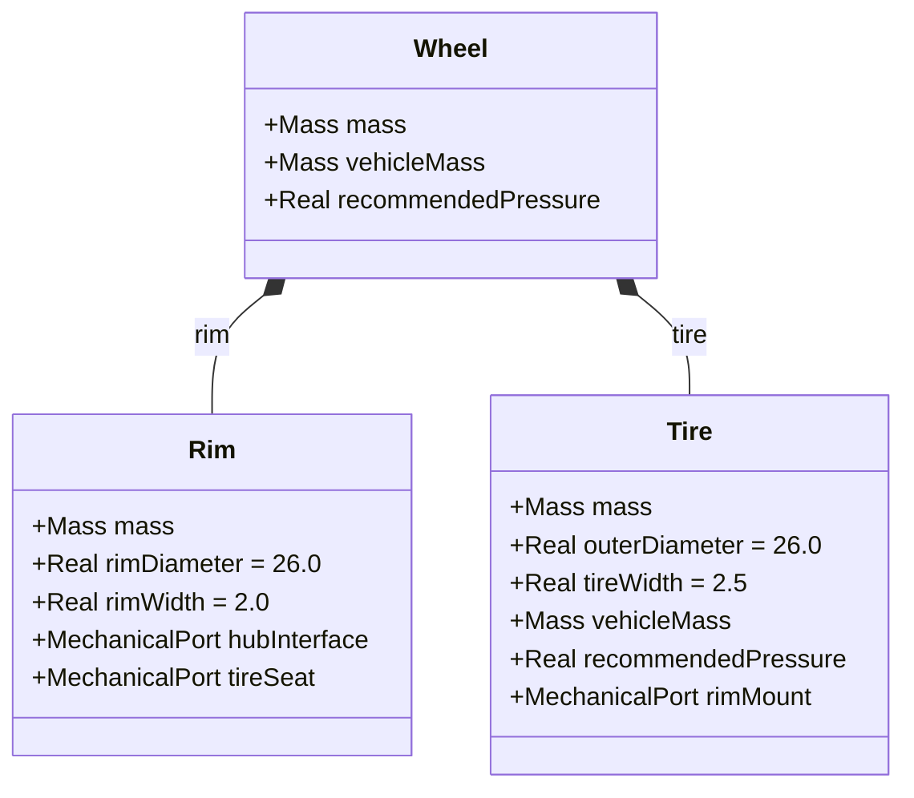
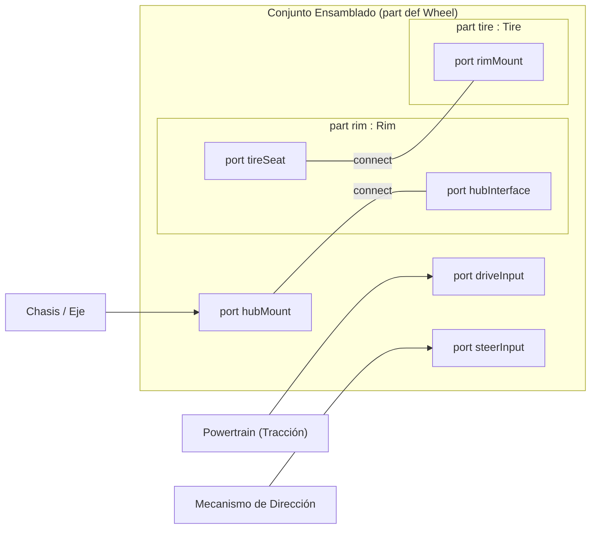

# Guía Pedagógica: Funcionamiento y Modelado de la Rueda en SysML v2

Este documento describe con fines formativos la arquitectura, sintaxis y funcionamiento del archivo [`Modelos/05_rueda.sysml`](file:///C:/Users/joseev/OneDrive%20-%20Universidad%20de%20Oviedo/Universidad/Cuarto/Primer%20Cuatri/Robotica%20industrial/Coche-sysml-/Modelos/05_rueda.sysml), correspondiente al subsistema de rueda del triciclo eléctrico ligero.

---

## 1. Visión General del Paquete (`SubsistemaRueda`)

El subsistema se encapsula dentro de un paquete SysML v2:

```sysml
package SubsistemaRueda {
    doc /* Definicion del conjunto de rueda descompuesto en llanta y neumatico */
    private import ScalarValues::*;
    private import TiposBase::*;
    ...
}
```

### Conceptos Clave:
- **`package`**: Espacio de nombres que agrupa de forma modular todos los elementos relacionados con la rueda, evitando colisiones con otros subsistemas (chasis, powertrain, dirección).
- **`doc /* ... */`**: Documentación formal integrada en el propio modelo de SysML v2.
- **`private import`**: Importa definiciones requeridas únicamente para el ámbito interno de este paquete:
  - `ScalarValues::*`: Proporciona tipos primitivos estándar como `Real`.
  - `TiposBase::*`: Proporciona tipos de datos del proyecto definidos en [`00_tipos_base.sysml`](file:///C:/Users/joseev/OneDrive%20-%20Universidad%20de%20Oviedo/Universidad/Cuarto/Primer%20Cuatri/Robotica%20industrial/Coche-sysml-/Modelos/00_tipos_base.sysml) (como la magnitud física `Mass` y la interfaz `MechanicalPort`).
- **Motivación física**: En ingeniería automotriz, una rueda no es un bloque homogéneo; está formada por un elemento rígido estructural que soporta el anclaje y el par (la llanta) y un elemento deformable que asegura la adherencia y amortiguación mediante aire a presión (el neumático). Modelarlos por separado permite asignarles propiedades mecánicas, restricciones de masa y fórmulas de inflado independientes.

---

## 2. Descomposición Estructural (Diagrama BDD)

En SysML v2, la estructura física se modela distinguiendo entre **definiciones de parte** (`part def`) y **usos de parte** (`part`).

### 2.1 Definiciones de Parte

1. **`part def Rim` (Llanta)**:
   - Representa la estructura metálica que se ancla al buje del vehículo y sobre la que asienta la cubierta.
   - **Atributos**:
     - `mass : Mass`: Masa de la llanta (en kg).
     - `rimDiameter : Real = 26.0`: Diámetro de la llanta (pulgadas), inicializado por defecto a 26".
     - `rimWidth : Real = 2.0`: Ancho de la llanta (pulgadas), inicializado a 2".
   - **Puertos**:
     - `hubInterface : MechanicalPort`: Puerto para atornillar/acoplar al buje del eje.
     - `tireSeat : MechanicalPort`: Asiento perimetral donde sella el talón del neumático.

2. **`part def Tire` (Neumático)**:
   - Representa la cubierta elástica que contiene la cámara de aire y hace contacto con el suelo.
   - **Atributos**:
     - `mass : Mass`: Masa de la goma y cámara.
     - `outerDiameter : Real = 26.0`: Diámetro exterior total de rodadura en pulgadas.
     - `tireWidth : Real = 2.5`: Balón o anchura del neumático en pulgadas.
     - `vehicleMass : Mass`: Carga del vehículo asignada a esta rueda.
     - `recommendedPressure : Real`: Presión calculada de inflado (en bar).
   - **Puertos**:
     - `rimMount : MechanicalPort`: Labio de montaje que asienta sobre la llanta.

3. **`part def Wheel` (Conjunto Rueda Ensamblado)**:
   - Agrupa la llanta y el neumático mediante composición (`part rim : Rim;` y `part tire : Tire;`).
   - Expone atributos globales del conjunto (`mass`, `vehicleMass`, `recommendedPressure`).

### 2.2 Diagrama Conceptual BDD (Jerarquía de Partes)



---

## 3. Modelado Paramétrico y Restricciones (`assert constraint`)

SysML v2 permite definir restricciones matemáticas mediante `assert constraint`. Estas ecuaciones no son meras asignaciones, sino relaciones invariantes que el solver o validador del modelo debe garantizar.

### 3.1 Presión recomendada del neumático (`calculateTirePressure`)

```sysml
assert constraint calculateTirePressure {
    recommendedPressure == 1.8 + (vehicleMass * 0.012)
}
```
- **Significado físico**: La presión recomendada parte de una presión base de `1.8 bar` (vehículo en vacío) y se incrementa linealmente en función de la masa soportada (`vehicleMass * 0.012 bar/kg`).
- **Sintaxis SysML v2**: Se utiliza el operador de igualdad relacional `==` dentro del bloque de aserción.

### 3.2 Balance de masa del conjunto (`wheelMassBalance`)

```sysml
assert constraint wheelMassBalance {
    mass == rim.mass + tire.mass
}
```
- **Significado físico**: Garantiza la conservación de la masa total; la masa de la rueda ensamblada es exactamente la suma de su llanta y su neumático.

### 3.3 Propagación de parámetros (`propagateParams`)

```sysml
assert constraint propagateParams {
    tire.vehicleMass == vehicleMass and
    recommendedPressure == tire.recommendedPressure
}
```
- **Significado físico**: Comunica bidireccionalmente las variables entre el nivel superior (`Wheel`) y el elemento interno (`Tire`):
  - La carga del vehículo recibida por la rueda se traslada a `tire.vehicleMass`.
  - La presión calculada en el neumático se refleja como la presión recomendada de la rueda completa.

---

## 4. Interfaces y Conectividad (Diagrama IBD)

Para que los componentes interactúen tanto entre sí como con el chasis, motor y dirección, se utilizan puertos (`port`) y conectores (`connect`).

### 4.1 Conexiones Internas
Dentro de `Wheel`, se enlazan los puertos de las subpartes:
```sysml
connect rim.tireSeat to tire.rimMount;
connect hubMount to rim.hubInterface;
```
1. `rim.tireSeat to tire.rimMount`: Representa la interfaz física de montaje entre el asiento de la llanta y el talón del neumático.
2. `hubMount to rim.hubInterface`: Delega el puerto externo de la rueda (`hubMount`) hacia la interfaz estructural de la llanta (`rim.hubInterface`).

### 4.2 Puertos Externos de la Rueda
El bloque `Wheel` ofrece tres puntos de conexión hacia el exterior del triciclo:
- **`hubMount : MechanicalPort`**: Anclaje al eje/buje del chasis (soporte de peso y fijación mecánica).
- **`driveInput : MechanicalPort`**: Entrada de par motor mecánico (acoplable al powertrain cuando la rueda es motriz, por ejemplo la rueda trasera).
- **`steerInput : MechanicalPort`**: Entrada de par de dirección (acoplable al mecanismo Ackermann cuando la rueda es directriz, por ejemplo las ruedas delanteras).

### 4.3 Diagrama Conceptual IBD (Flujo de Conexiones)



---

## 5. Visualización e Inspección con Spec42 en VS Code

Al abrir el proyecto en VS Code con la extensión **Spec42 (SysML v2)**:
1. **Vista de Explorador de Modelos**: Permite desplegar el paquete `SubsistemaRueda` y visualizar las tres definiciones de parte (`Rim`, `Tire`, `Wheel`).
2. **Diagrama BDD (Block Definition Diagram)**: Al solicitar la vista de definición de bloques de `Wheel`, Spec42 dibuja la composición con las dos subpartes `rim` y `tire`.
3. **Diagrama IBD (Internal Block Diagram)**: Al solicitar la vista interna de `Wheel`, Spec42 dibuja el límite del bloque, las cajas internas de `rim` y `tire`, y las líneas de conexión de los puertos mecánicos.
