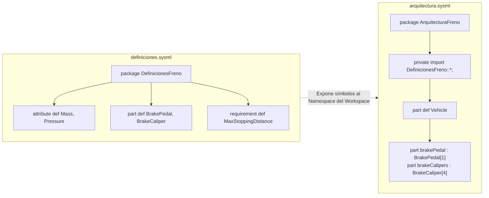

# Modularización del Sistema de Freno en SysML v2

Este módulo divide el modelo del sistema de frenado en dos archivos desacoplados siguiendo el estándar de **SysML v2**: **Definiciones reutilizables** y **Arquitectura / Ensamblado**.

---

## Estructura de Archivos

- **`definiciones.sysml` (`package DefinicionesFreno`)**:
  - Contiene los tipos base, datos y especificaciones reutilizables.
  - **Definición de atributos (`attribute def`)**: `Mass :> Real` y `Pressure :> Real`.
  - **Definición de partes (`part def`)**: Tipos de componentes `BrakePedal` y `BrakeCaliper`.
  - **Definición de requisitos (`requirement def`)**: Requisito `MaxStoppingDistance`.

- **`arquitectura.sysml` (`package ArquitecturaFreno`)**:
  - Modela la composición y ensamblado del vehículo (`part def Vehicle`) tipando los subsistemas y asignando multiplicidades:
    - `attribute mass : Mass;`
    - `part brakePedal : BrakePedal[1];`
    - `part brakeCalipers : BrakeCaliper[4];`
  - Declara la instancia de uso `part vehiculo : Vehicle;`.

---

## ¿Cómo se Comunican Ambos Archivos?

A diferencia de lenguajes como C (`#include "archivo.h"`) o JavaScript (`import { x } from "./archivo.js"`), **SysML v2 no enlaza archivos mediante rutas de disco ni URLs**, sino a través de un **sistema unificado de espacios de nombres (Namespace System) y resolución de paquetes**.



### 1. Indexación del Workspace (Global Namespace)
Cuando abres el directorio en una herramienta SysML v2 (como Eclipse SysON o el CLI de SysML v2), el entorno inspecciona todos los ficheros `.sysml` presentes en el workspace:
1. Lee `definiciones.sysml` y registra en la tabla de símbolos global el paquete `DefinicionesFreno`.
2. Lee `arquitectura.sysml` y registra el paquete `ArquitecturaFreno`.
3. Ninguno de los dos archivos necesita saber el nombre de archivo del otro en el disco (`definiciones.sysml`); solo conocen el **nombre del paquete** (`DefinicionesFreno`).

### 2. La Directiva de Importación
La comunicación y transferencia de símbolos se realiza en la cabecera de `arquitectura.sysml`:

```sysml
private import DefinicionesFreno::*;
```

- **`DefinicionesFreno`**: Es el identificador exacto del paquete declarado en `definiciones.sysml`.
- **`::*` (Comodín / Wildcard)**: Importa todos los elementos públicos del paquete de definiciones al ámbito de `ArquitecturaFreno`, permitiendo escribir directamente `BrakePedal` en lugar de `DefinicionesFreno::BrakePedal`.
- **`private` (Modificador de Visibilidad)**:
  - Indica que los elementos importados solo estarán accesibles dentro de `ArquitecturaFreno`.
  - Si otro tercer paquete importara `ArquitecturaFreno`, los tipos de `DefinicionesFreno` no se reexportarán automáticamente, manteniendo el principio de encapsulación.

### 3. Métodos Alternativos de Comunicación entre Paquetes
En SysML v2 también es posible comunicarse entre ambos archivos de formas más selectivas:

- **Importación específica de un único tipo**:
  ```sysml
  private import DefinicionesFreno::BrakeCaliper;
  ```
- **Referencia cualificada completa (sin import)**:
  ```sysml
  part calipers : DefinicionesFreno::BrakeCaliper[4];
  ```

---

## Resumen de Reglas Clave

1. **Coexistencia en el Workspace**: Ambos ficheros deben estar en el mismo proyecto/directorio reconocido por el entorno de SysML v2 para que el resolvedor de dependencias enlace los paquetes.
2. **Nombres Únicos de Paquete Raíz**: Los nombres de los paquetes a nivel raíz (`DefinicionesFreno` y `ArquitecturaFreno`) deben ser únicos en todo el modelo para evitar colisiones de identificadores.
3. **Separación de Responsabilidades**:
   - `definiciones.sysml` define **qué elementos existen** (`*def`).
   - `arquitectura.sysml` define **cómo se ensamblan y usan** (`part`, `attribute`, multiplicidades).
